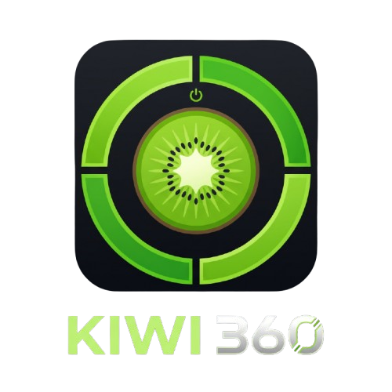

<!--
SPDX-FileCopyrightText: Copyright 2026 Kiwi360 Project
SPDX-License-Identifier: LicenseRef-PolyForm-Shield-1.0.0
-->

<p align="center">
  
</p>

# Kiwi360

An Xbox 360 emulator for Android (ARM64, Vulkan), built on [Xenia Edge](https://github.com/has207/xenia-edge), the
fork of [Xenia](https://github.com/xenia-project/xenia).

Source code: <https://git.kiwi360.org/Kiwi360/Kiwi360> (mirror: <https://github.com/Ghael-V/Kiwi360>).

> Kiwi360 is in an early testing stage. Many games boot and some are playable on recent Snapdragon devices; expect
> bugs, and share your logs (Settings → Share logs) when something goes wrong.

## What Kiwi360 adds

- **A library made for handhelds and phones**, in a Metro style: real game names and icons read from the discs, multi-disc
  games as one entry, play time, achievements, installed content (updates and DLC, also kept beside the game or moved
  to the SD card), save import and export, per-game options, a controller-first UI that also works by touch.
- **An in-game menu** (Back, Select+Start, or a swipe from the screen edge) with settings applied live and kept per game,
  an on-screen gamepad when no controller is connected, and a performance HUD.
- **GPU drivers**: Lemon-Ade (a Turnip/Mesa build for Adreno) is bundled and used by default on Qualcomm GPUs, where it
  avoids rendering bugs of the stock driver; other drivers can be downloaded or imported, globally or per game.
- **Lemon FG frame generation**, **image effects** (19 effects and presets, also on generated frames) and
  **recommended settings**: per-game settings suggested by an AI server for your game and device, undone
  automatically if the game fails to start with them.
- **Emulation work for mobile GPUs**: zero-copy guest memory shared with the GPU, structured shader control flow,
  asynchronous submission, descriptor and texture-reload caches, exact vertex rounding where Adreno and Mali lack it,
  and more, each behind a switch so it can be compared.

## Requirements

- Android 11 or later, 64-bit.
- A CPU with ARMv8.2 (Snapdragon 845 or later, or an equivalent MediaTek, Exynos or Tensor). Older Cortex-A53/A73 chips
  (Snapdragon 4xx and 6xx) are not supported: Kiwi360 tells you so instead of starting.
- A Vulkan GPU. Development and testing happen on the Adreno 830 (AYN Odin 3); Mali is tested on a Mali-G615.
- Your own game dumps (ISO, XEX folders, GOD/STFS packages). Kiwi360 does not include or download any game.

## Building

The emulator core is a native library built with CMake and the Android NDK; the app in `android/kiwi360` is a Gradle
project that packages it.

1. Build `xenia-shader-cc` for your PC (a host CMake build of this repository); Android builds use the host's to
   compile the shaders.
2. Build the core for Android (NDK 28.2, API 30, arm64-v8a):

   ```sh
   cmake -S . -B build-android -G Ninja -DCMAKE_BUILD_TYPE=Release \
     -DCMAKE_TOOLCHAIN_FILE=$ANDROID_NDK/build/cmake/android.toolchain.cmake \
     -DANDROID_ABI=arm64-v8a -DANDROID_PLATFORM=android-30 \
     -DXE_HOST_SHADER_CC=/path/to/xenia-shader-cc
   ninja -C build-android xenia-app
   ```

3. Copy `build-android/bin/Linux/*.so` into `android/kiwi360/app/src/main/jniLibs/arm64-v8a/` and build the app with
   JDK 17: `cd android/kiwi360 && ./gradlew assembleDebug` (or `assembleRelease`, then sign the APK with your own key).

The licence notices shown in the app are generated by `android/kiwi360/tools/gen_third_party_notices.py`, and the
recommended-settings schema by `android/kiwi360/tools/ai-schema/gen_schema.py`.

## License

- **Xenia and Xenia Edge** code, including Kiwi360's changes inside their files, is under the BSD 3-Clause license
  ([LICENSE](LICENSE)).
- **Kiwi360's own files** (those carrying `SPDX-License-Identifier: LicenseRef-PolyForm-Shield-1.0.0`) are under the
  [PolyForm Shield License 1.0.0](https://polyformproject.org/licenses/shield/1.0.0): you may use, change and share
  them, but not to build a product that competes with Kiwi360. See [LICENSE-Kiwi360](LICENSE-Kiwi360) and
  [LICENSES/](LICENSES).
- **Third-party components** keep their own licenses: [THIRD_PARTY_LICENSES.md](THIRD_PARTY_LICENSES.md). LGPL libraries
  (FFmpeg, libmspack) are shipped as separate shared libraries, with their source offered alongside each release.

Every file states its license in an SPDX header or in a `REUSE.toml`.

## Credits

Kiwi360 stands on the work of the [Xenia](https://xenia.jp) team and contributors and of Xenia Edge; on Mesa's Turnip
driver; and on libadrenotools, SDL, FFmpeg, libmspack and the other projects listed in the third-party licenses. Lemon FG
and the image effects come from the author's other emulators, Lemon and CapyPS5.

The upstream Xenia Edge README is kept as [README.xenia-edge.md](README.xenia-edge.md).

Xbox and Xbox 360 are trademarks of Microsoft. Kiwi360 is not affiliated with or endorsed by Microsoft.
